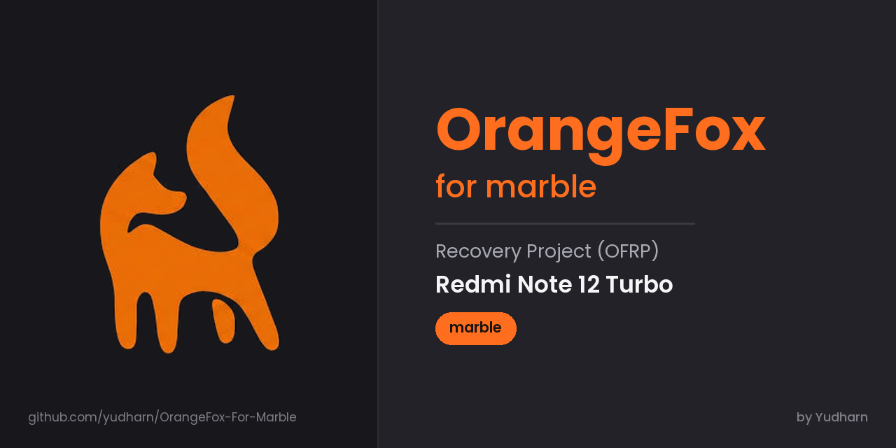

  

  
  
  

# OrangeFox Recovery for Redmi Note 12 Turbo (marble)

This repo is where I build OrangeFox Recovery (OFRP) for the Redmi Note 12 Turbo, codename **marble**. There is no device tree stored here. GitHub Actions pulls the `fox_12.1` sources, clones the device tree, builds the recovery, and uploads the zip to Releases.

The default device tree is [Ctapchuk/android_device_xiaomi_marble-OFRP](https://github.com/Ctapchuk/android_device_xiaomi_marble-OFRP), branch `fox_12.1`. If you want to try a different tree, change `DEVICE_TREE_URL` and `DEVICE_TREE_BRANCH` when you run the workflow.

## What's in the repo

- `.github/workflows/OrengeFox.yml` - the build workflow
- `.github/dependabot.yml` - weekly GitHub Actions updates
- `assets/social-preview.png` - repo banner

## Features

- OrangeFox theme with dark mode
- Flash zip, img, and OTA files
- File manager, terminal, and aFTP
- Backup and restore partitions
- Data decryption, safe to use with format data
- MTP, ADB sideload, and ADB shell

## Building

1. Open the **Actions** tab, pick **Recovery OFOX Build (fox_12.1) — marble**, then click **Run workflow**.
2. Leave the defaults or change the inputs (device tree, branch, maintainer name, patch version).
3. Wait around an hour. If it succeeds, the zip shows up under **Releases**.

Only the repo owner can start the workflow. If a build fails, the full `build.log` is uploaded as an artifact and kept for 7 days.

## Installing

Each release contains one zip, named something like `OrangeFox-R12.0_<patch>-Unofficial-marble.zip`.

1. Download the zip from **Releases**.
2. Boot into a working custom recovery (an older OrangeFox or TWRP build for marble will do).
3. Flash the zip.
4. Reboot back into recovery to check that it worked.

There is no `.img` in the release, so the zip has to be flashed from an existing custom recovery. Your bootloader also needs to be unlocked.

## Credits

- [OrangeFox Recovery Project](https://orangefox.tech)
- [Ctapchuk/android_device_xiaomi_marble-OFRP](https://github.com/Ctapchuk/android_device_xiaomi_marble-OFRP) - device tree
- Everyone in the TWRP/OFRP community who helped with marble

## Disclaimer

Flashing a custom recovery can void your warranty, cause a bootloop, or brick the phone if something goes wrong. You do it at your own risk. I'm not responsible for any damage to your device.

## License

Apache License 2.0, same as the upstream OrangeFox/TWRP/AOSP licensing.
